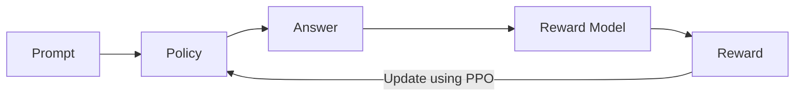

# Artificial Intelligence (AI) & Machine Learning (ML) — General Notes

## 55. AI, ML, Deep Learning, and GenAI

Source: “Humans are a mix of AI” course slide by Stephane Maarek.

The slide uses human behavior as an analogy:

- **Artificial Intelligence (AI):** Sometimes we know “if this happens, then do that.”
- **Machine Learning (ML):** Sometimes we have seen a lot of similar things before, and we classify them.
- **Deep Learning:** Sometimes we have not seen something before, but we have “learned” a lot of similar concepts, so we can make a decision.
- **Generative AI (GenAI):** Sometimes we get creative and, based on what we have learned, we can generate content.

The diagram shows nested areas, from broadest to most specific:

**Artificial Intelligence → Machine Learning → Deep Learning → Generative AI**

Each area is shown inside the preceding one: Machine Learning within AI, Deep Learning within Machine Learning, and Generative AI within Deep Learning.

## ML Terms You May Encounter in the Exam

Source: Ultimate AWS Certified AI Practitioner AIF-C01 course slide.

- **GPT (Generative Pre-trained Transformer)** – generate human text or computer code based on input prompts.
- **BERT (Bidirectional Encoder Representations from Transformers)** – similar intent to GPT, but reads the text in two directions.
- **RNN (Recurrent Neural Network)** – meant for sequential data such as time-series or text; useful in speech recognition and time-series prediction.
- **ResNet (Residual Network)** – Deep Convolutional Neural Network (CNN) used for image recognition tasks, object detection, and facial recognition.
- **SVM (Support Vector Machine)** – ML algorithm for classification and regression.
- **WaveNet** – model to generate raw audio waveform, used in speech synthesis.
- **GAN (Generative Adversarial Network)** – models used to generate synthetic data such as images, videos, or sounds that resemble the training data. Helpful for data augmentation.
- **XGBoost (Extreme Gradient Boosting)** – an implementation of gradient boosting.

## 61. Reinforcement Learning

### What Is Reinforcement Learning (RL)?

Source: “What is Reinforcement Learning (RL)?” course slide.

Reinforcement Learning is a type of Machine Learning where an agent learns to make decisions by performing actions in an environment to maximize cumulative rewards.

### Key Concepts

| Concept | Meaning |
| --- | --- |
| **Agent** | The learner or decision-maker. |
| **Environment** | The external system the agent interacts with. |
| **Action** | The choices made by the agent. |
| **Reward** | The feedback from the environment based on the agent’s actions. |

### Grid Example

The diagram shows a robot starting at the bottom-left of a grid and an exit at the top-right. Ordinary cells are marked **−1**, cells along the orange obstacles are marked **−10**, and the exit is marked **+100**. These rewards illustrate how the agent can learn to reach the exit while minimizing penalties and maximizing cumulative reward.

### Applications of Reinforcement Learning

Source: “Applications of Reinforcement Learning” course slide.

- **Gaming** – teaching AI to play complex games (e.g., Chess, Go).
- **Robotics** – navigating and manipulating objects in dynamic environments.
- **Finance** – portfolio management and trading strategies.
- **Healthcare** – optimizing treatment plans.
- **Autonomous Vehicles** – path planning and decision-making.

## 62. Reinforcement Learning from Human Feedback (RLHF)

### How Does RLHF Work?

Source: “How does RLHF work? Example: internal company knowledge chatbot” course slide.

The slide describes four stages using an internal company knowledge chatbot as an example.

### 1. Data Collection

- Create a set of human-generated prompts and responses.
- Example prompt: “Where is the location of the HR department in Boston?”

### 2. Supervised Fine-Tuning of a Language Model

- Fine-tune an existing model with internal knowledge.
- The model creates responses for the human-generated prompts.
- Responses are mathematically compared to human-generated answers.

### 3. Build a Separate Reward Model

- Humans indicate which response they prefer for the same prompt.
- The reward model learns to estimate human preferences for responses to a prompt.

### 4. Optimize the Language Model Using the Reward Model

- Use the reward model as a reward function for Reinforcement Learning.
- This optimization stage can be fully automated.

### RLHF Process Diagram

Source: “RLHF Process” course slide, referencing [AWS: What is RLHF?](https://aws.amazon.com/what-is/reinforcement-learning-from-human-feedback/).

The diagram groups the process into three training steps, with demonstration data collection included in the first step.

| Step | Data and training | Result |
| --- | --- | --- |
| **1. Supervised Fine-Tuning (SFT)** | Collect human demonstration data and use it to fine-tune a base large language model (LLM). | A supervised fine-tuned model (SFT). |
| **2. Training a Reward Model (RM)** | Give the SFT model a prompt to generate candidate answers. Humans rank the answers (for example, Answer 1 > Answer 2). Use this human preference data to train a reward model from a base LLM. | A reward model that scores responses according to learned human preferences. |
| **3. Optimize Policy** | The policy generates an answer to a prompt. The reward model evaluates the answer and returns a reward, which is used to update the policy. The diagram labels this optimization method **PPO (Proximal Policy Optimization)**. | An updated policy, meaning the language model being optimized. |

The final step forms a feedback loop:

## 64. Model Evaluation Metrics

### Confusion Matrix

Source: “Confusion Matrix - continued” course slide by Stephane Maarek.

A confusion matrix evaluates the performance of a classification model by comparing actual classes with predicted classes. It can cover multiple classes, as in the three-class sentiment example below.

Rows represent **actual** classes; columns represent **predicted** classes.

| Actual / Predicted | Negative | Neutral | Positive |
| --- | --- | --- | --- |
| **Negative** | 700 | 300 | 0 |
| **Neutral** | 200 | 8300 | 100 |
| **Positive** | 0 | 100 | 300 |

The diagonal entries are correct predictions; the other entries are misclassifications. This dataset is imbalanced: it contains 1,000 actual negative examples, 8,600 neutral examples, and 400 positive examples.

### Choosing an Evaluation Metric

| Metric | When to use it |
| --- | --- |
| **Precision** | When false positives are costly. |
| **Recall** | When false negatives are costly. |
| **F1 Score** | When you want a balance between precision and recall, especially with imbalanced datasets. |
| **Accuracy** | Best suited to balanced datasets. |

### Regression Metrics

Source: “Model Evaluation – Regression Metrics” course slide.

**MAE, MAPE, RMSE, and R²** evaluate regression models, which predict a **continuous value**. Example: predicting students’ test scores based on how many hours they study.

| Metric | Full name | What it measures |
| --- | --- | --- |
| **MAE** | Mean Absolute Error | The average absolute difference between predicted and actual values. |
| **MAPE** | Mean Absolute Percentage Error | The average absolute prediction error expressed as a percentage of actual values. It is undefined when an actual value is zero. |
| **RMSE** | Root Mean Squared Error | The square root of the average squared prediction error, expressed in the same units as the target. Larger errors receive more weight. |
| **R²** | R Squared (coefficient of determination) | The proportion of variance explained by the model relative to predicting the mean. |

**MAE, MAPE, and RMSE measure prediction error:** lower values indicate less error.

- **RMSE example:** If RMSE is 5, the model’s errors have a root mean square magnitude of 5 test-score points. This gives a sense of the typical error size; it is not the same as an average absolute error of 5 points.
- **R² example:** If R² is 0.8, the model using study hours explains 80% of the observed variation in test scores, leaving 20% unexplained. This does not establish that study hours caused that variation or identify the causes of the unexplained portion.

## 65. Machine Learning Inferencing

### Inferencing at the Edge

Source: “Inferencing at the Edge” course slide by Stephane Maarek.

**Edge devices** are located close to where data is generated. They usually have less computing power and may operate in places with limited internet connectivity. The slide uses a **Raspberry Pi** as an example.

### Local SLM vs. Remote LLM

| Aspect | Small Language Model (SLM) on the edge device | Large Language Model (LLM) on a remote server |
| --- | --- | --- |
| **Model and compute** | Low compute footprint, suitable for a device with limited resources. | More powerful model hosted on a remote server. |
| **Latency** | Very low latency from local inference. | Higher latency, including communication with the server. |
| **Connectivity** | Can perform inference offline. | Requires an online connection to access the server. |
| **Example in the diagram** | A Raspberry Pi runs the SLM directly. | A Raspberry Pi sends API calls over the internet to a server hosting the LLM and receives responses. |

**Key trade-off:** Local inference supports low latency and offline operation with a small compute footprint. Remote inference provides access to a more powerful model but requires connectivity and introduces higher latency.
