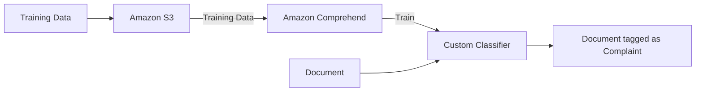

# AWS Managed AI Services — General Notes

Lectures 70–93.

## 71. Amazon Comprehend

Source: “Amazon Comprehend” course slide.

Amazon Comprehend is a **fully managed, serverless Natural Language Processing (NLP) service**. It uses machine learning to find insights and relationships in text.

### Capabilities

- **Language detection:** Identify the language of the text.
- **Key phrase and entity extraction:** Extract key phrases, places, people, brands, or events.
- **Sentiment analysis:** Identify how positive or negative the text is.
- **Syntax analysis:** Analyze text using tokenization and parts of speech.
- **Topic modeling:** Automatically organize a collection of text files by topic.

### Sample Use Cases

- Analyze customer interactions, such as emails, to identify what leads to a positive or negative experience.
- Discover topics in a collection of articles and group the articles by those topics.

### Custom Classification

Source: “Comprehend – Custom Classification” course slide.

- Organize documents into categories (**classes**) that you define.
- Example: categorize customer emails by request type so that you can provide appropriate guidance.
- Supports different document types, including text, PDF, Word, and images.

#### Analysis Modes

| Mode | Documents | Processing |
| --- | --- | --- |
| **Real-time analysis** | A single document | Synchronous |
| **Async analysis** | Multiple documents in a batch | Asynchronous |

#### Training and Classification Workflow

1. Store training data in **Amazon S3**.
2. Use the training data in **Amazon Comprehend** to train a **custom classifier**.
3. Submit a document to the classifier to assign a category, such as **Complaint**.

## 92. Amazon’s Hardware for AI

### Amazon EC2

Source: “Amazon EC2” course slide.

- **EC2** stands for **Elastic Compute Cloud** and is an **Infrastructure as a Service (IaaS)** offering.
- It is one of AWS’s most popular offerings. Understanding EC2 is fundamental to understanding how the cloud works.

The slide introduces EC2 alongside related services for storage, load balancing, and scaling:

| Capability | Service or resource |
| --- | --- |
| Rent virtual machines | **Amazon EC2** instances |
| Store data on virtual drives | **Amazon Elastic Block Store (EBS)** |
| Distribute load across machines | **Elastic Load Balancing (ELB)** |
| Scale the number of instances | **EC2 Auto Scaling**, using an **Auto Scaling group (ASG)** |

### EC2 Sizing & Configuration Options

Source: “EC2 sizing & configuration options” course slide.

| Option | What to configure |
| --- | --- |
| **Operating system (OS)** | Linux, Windows, or macOS, depending on the instance offering. |
| **CPU** | Compute power and number of cores. |
| **RAM** | Amount of random-access memory. |
| **Storage** | Capacity and storage type: network-attached **EBS** or **Amazon Elastic File System (EFS)**, or local hardware storage through **EC2 Instance Store**. |
| **Networking** | Network performance and public IP address configuration. |
| **Firewall rules** | **Security groups** control allowed inbound and outbound traffic. |
| **Bootstrap script** | **EC2 User Data** configures the instance at first launch. |

### AI Hardware: GPUs, Trainium, and Inferentia

Source: “Amazon’s Hardware for AI” course slide.

#### GPU-Based EC2 Instances

- Examples shown: **P3, P4, P5**, and **G3 through G6** instance families.

#### AWS Trainium

- An ML chip designed for **deep learning training**, including models with **100 billion or more parameters**.
- The slide gives a **Trn1** configuration with **16 Trainium accelerators** as an example; accelerator count depends on instance size.
- The slide cites a **50% cost reduction** when training a model.

#### AWS Inferentia

- An ML chip designed to deliver **high-performance, low-cost inference**.
- **Inf1** and **Inf2** instances are powered by AWS Inferentia.
- The slide cites **up to 4× throughput** and **70% cost reduction**.

#### Environmental Footprint and Comparison Figures

- The slide describes **Trn** and **Inf** instances as having the **lowest environmental footprint**.
- The slide does not specify the comparison baselines or conditions for its cost, throughput, or environmental claims; these figures should be read as slide claims rather than universal guarantees.

**Key distinction:** **Trainium → training; Inferentia → inference.**
