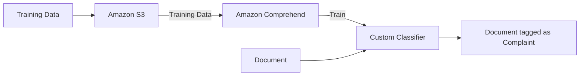

# AWS Managed AI Services — General Notes

Lectures 70–93.

## 71. Amazon Comprehend

Source: “Amazon Comprehend” course slide.

Amazon Comprehend is a **fully managed, serverless Natural Language Processing (NLP) service**. It uses machine learning to find insights and relationships in text.

### Capabilities

- **Language detection:** Identify the language of the text.
- **Key phrase and entity extraction:** Extract key phrases, places, people, brands, or events.
- **Sentiment analysis:** Identify how positive or negative the text is.
- **Syntax analysis:** Analyze text using tokenization and parts of speech.
- **Topic modeling:** Automatically organize a collection of text files by topic.

### Sample Use Cases

- Analyze customer interactions, such as emails, to identify what leads to a positive or negative experience.
- Discover topics in a collection of articles and group the articles by those topics.

### Custom Classification

Source: “Comprehend – Custom Classification” course slide.

- Organize documents into categories (**classes**) that you define.
- Example: categorize customer emails by request type so that you can provide appropriate guidance.
- Supports different document types, including text, PDF, Word, and images.

#### Analysis Modes

| Mode | Documents | Processing |
| --- | --- | --- |
| **Real-time analysis** | A single document | Synchronous |
| **Async analysis** | Multiple documents in a batch | Asynchronous |

#### Training and Classification Workflow

1. Store training data in **Amazon S3**.
2. Use the training data in **Amazon Comprehend** to train a **custom classifier**.
3. Submit a document to the classifier to assign a category, such as **Complaint**.

